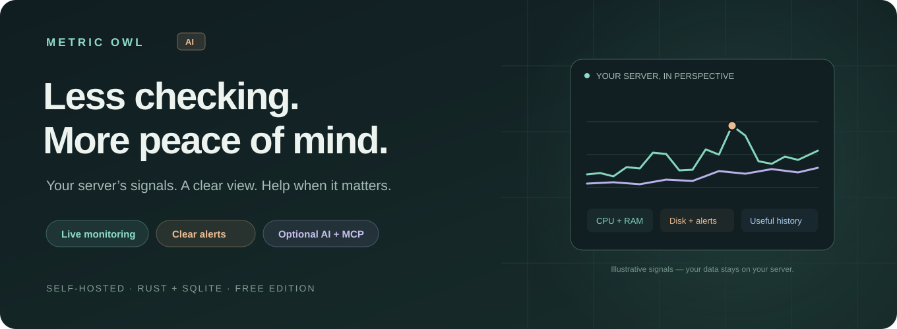
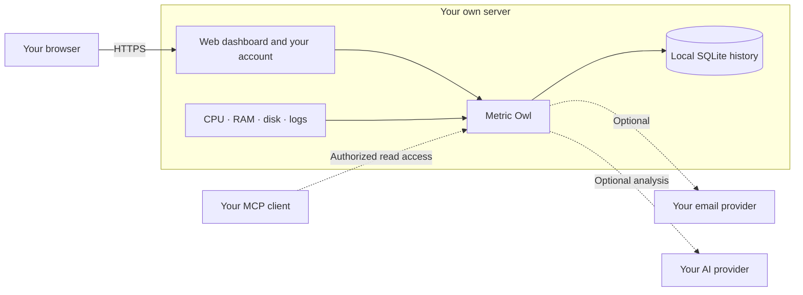

# Metric Owl

**Disk filling up? CPU overloaded? Memory running low?**
Metric Owl watches your server and helps you understand what needs attention.
Free, self-hosted monitoring with optional AI insight and read-only MCP.

[Website](https://metricowl.cloud/) · [Setup guide](docs/INSTALLATION.md) · [Preview scope](docs/PREVIEW.md)

## Install on your server

**Ubuntu or Debian x86-64 with a public IPv4 address. No domain or cloud account needed.**
The script detects your OS locally. [Versions and validation](docs/PREVIEW.md). Run on your server:

```bash
curl -fsSL https://raw.githubusercontent.com/SpeakQuery/metric-owl/v0.1.0-preview.4/scripts/bootstrap-linux.sh | sudo bash
```

1. Choose your administrator username and enter your password twice.
2. Open the printed **`https://YOUR_SERVER_IP:PORT/admin`** address and sign in.

The installer selects **8443**, or **9443 / 10443** if occupied, and prints the exact URL.
Port **80** (Metric Owl certificate validation) and the selected panel port must be reachable. [Network details](docs/OPERATIONS.md#network-access).

Nothing is installed on your viewing device. Two-factor authentication is optional.

[Inspect the installer](https://github.com/SpeakQuery/metric-owl/blob/v0.1.0-preview.4/scripts/bootstrap-linux.sh) · [Installation help](docs/INSTALLATION.md)

## Less checking. Clearer answers.

- **See the load:** live CPU, RAM, disk, network and process charts.
- **Hear when it matters:** ready-made alert rules, grouped incidents and optional email reports.
- **Understand changes:** performance history and evidence around incidents.
- **Ask your AI:** optional expert analysis and scoped, read-only MCP access.


*Actual application interface. Illustrative data, not access to a live server.*

## Your server, end to end

The application, dashboard, administrator account, metrics and SQLite database
all run on **your own server**. There is no shared Metric Owl cloud account.



Optional email, AI, MCP and webhooks share only the data needed for the connections
you enable. The public website has no shared login or dashboard. Open the address
printed by your installer.

## Bring your own AI assistant

Connect from **Setup guide → Set up MCP connection**, then ask:

> “Show CPU usage over the last 24 hours.”
>
> “When did CPU and memory rise together?”

MCP reads collected history. It cannot run commands or change server settings.
Routine monitoring works without AI. Monitoring runs while the host and agent are
online; whole-host outage alerts need an independent monitor.

<details>
<summary>More application screens</summary>


</details>

**Uninstall:** `sudo bash /usr/share/doc/server-guard/uninstall-linux.sh` — your account and history are retained. [Details](docs/OPERATIONS.md#remove-the-application).

[Advanced setup](docs/OPERATIONS.md) · [Email](docs/NOTIFICATIONS.md) · [Security](docs/SECURITY.md) · [Development](docs/DEVELOPMENT.md)

Official binaries are free under the [binary license](BINARY-LICENSE.txt).
Public source remains proprietary under [LICENSE](LICENSE), not an open-source license.
Optional provider charges are separate.
