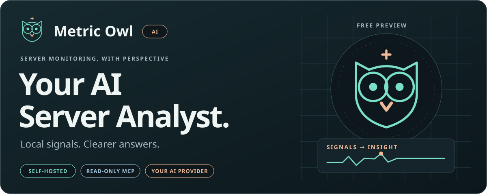
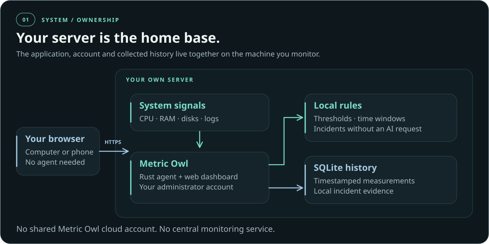
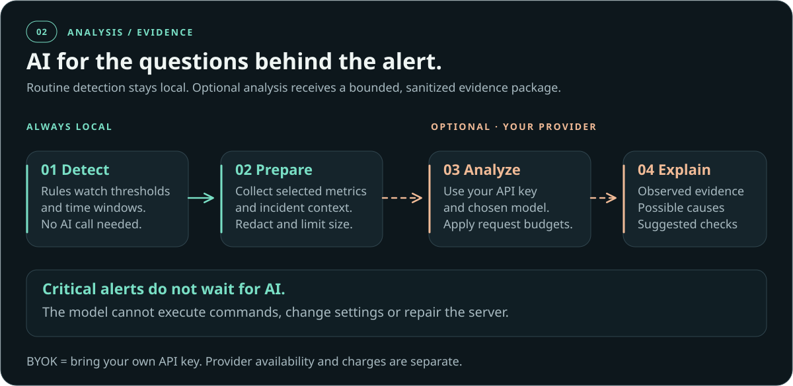
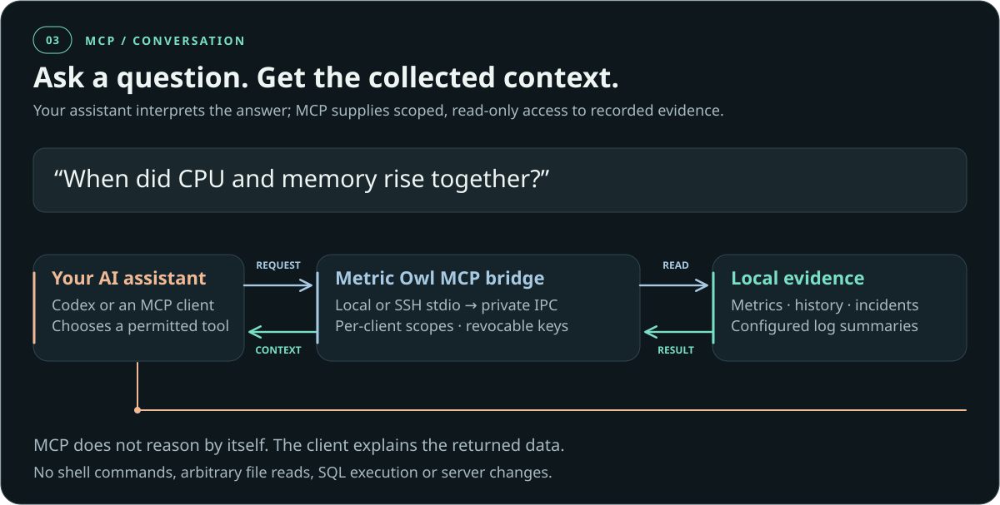
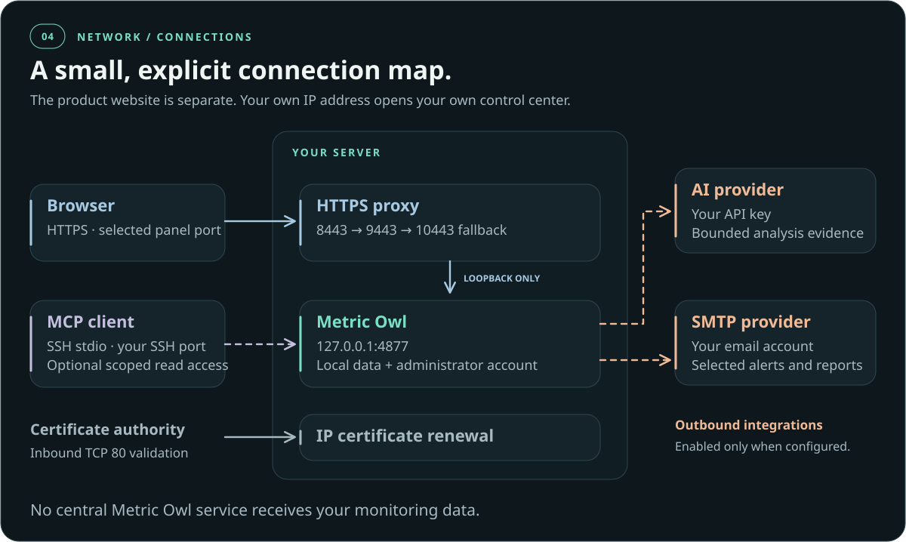
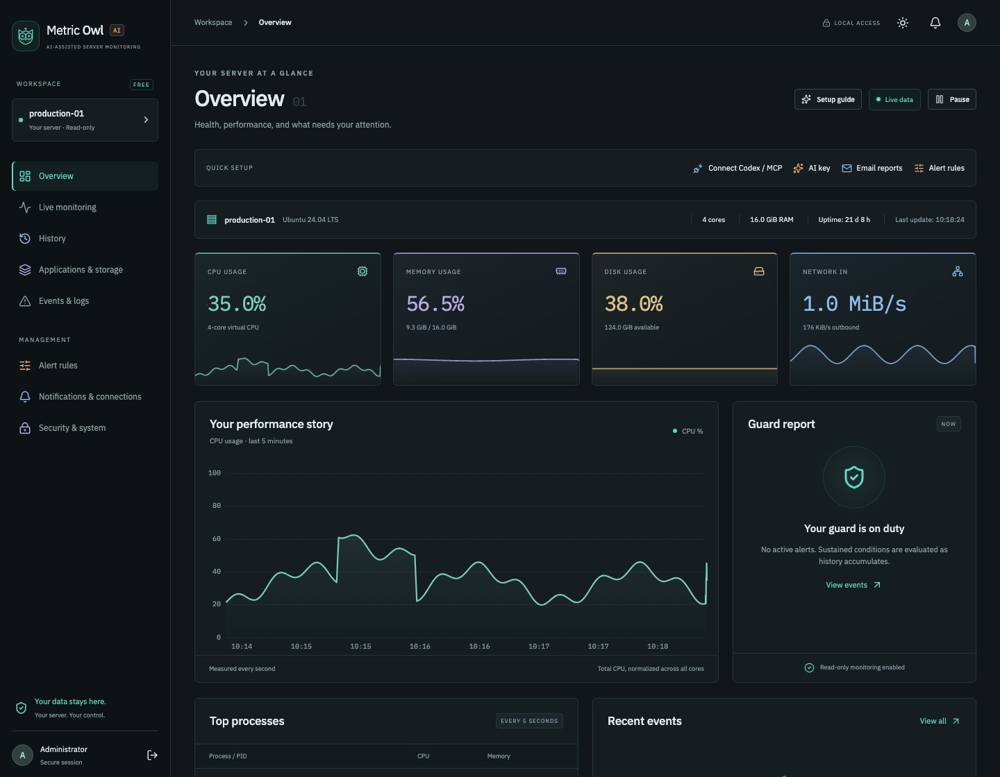
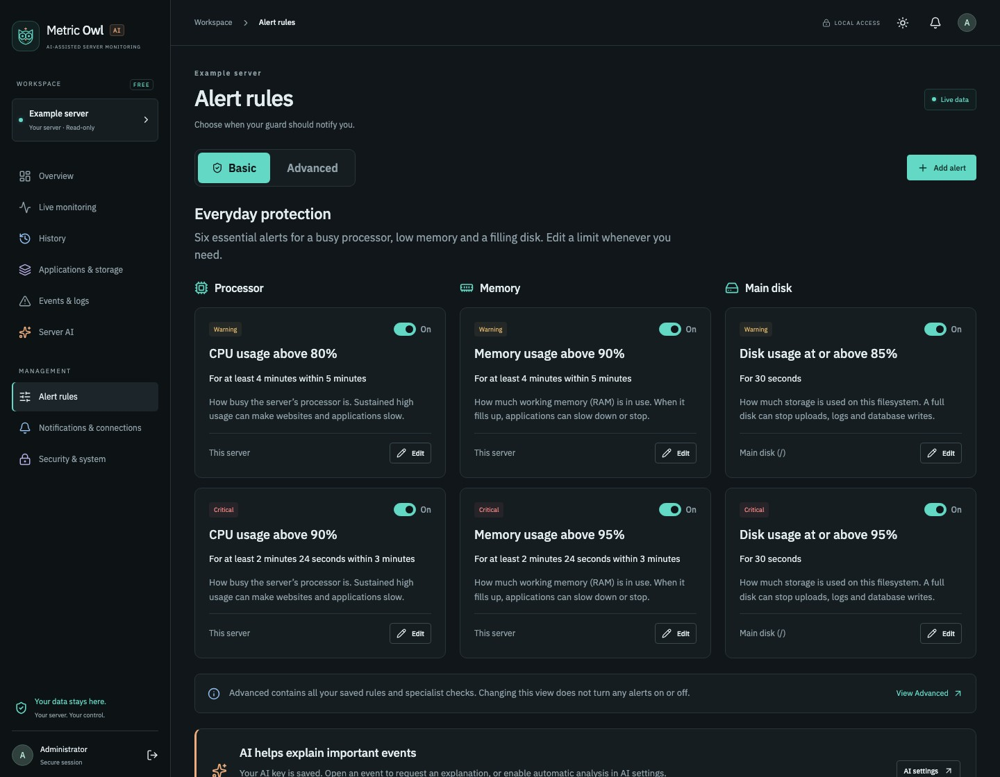
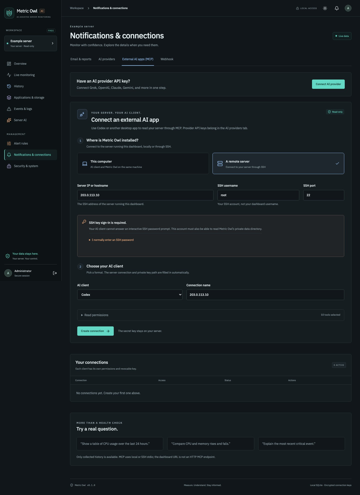
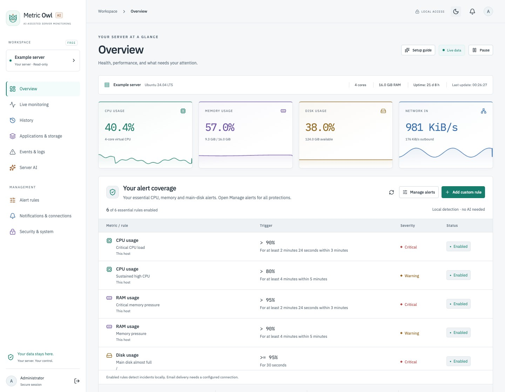

# Metric Owl · Your AI Server Analyst

**Turn server signals into a conversation you can understand.**
Watch live performance, catch problems with local rules, and give your AI assistant
the evidence to explain what changed. Free, open-source server monitoring under
[Apache License 2.0](LICENSE), optional
bring-your-own-key AI analysis, and read-only MCP for Codex and other clients.

[Website](https://metricowl.cloud/) · [Install](#install-on-your-server) · [AI analysis](#from-an-alert-to-an-explanation) · [MCP](#ask-your-server-a-better-question) · [Preview scope](docs/PREVIEW.md)

## Install on your server

**Ubuntu or Debian x86-64. Public IPv4 for HTTPS; no domain or cloud account needed.**
The script detects your OS locally. [Versions and validation](docs/PREVIEW.md). Run on your server:

```bash
curl -fsSL https://raw.githubusercontent.com/SpeakQuery/metric-owl/v0.1.0-preview.9/scripts/bootstrap-linux.sh | sudo bash
```

1. Choose your administrator username and enter your password twice. Select
   **HTTPS — open from any device (recommended)**, then review the detected IP
   and accept the Let’s Encrypt terms.
2. Open the printed **`https://YOUR_SERVER_IP:PORT/admin`** address and sign in.

The installer selects **8443**, or **9443 / 10443** if occupied, and prints the exact URL.
For HTTPS, port **80** (Metric Owl certificate validation) and the selected panel port must be reachable. [Network details](docs/OPERATIONS.md#network-access).

For private access, choose **Private — connect through SSH** and follow the printed
tunnel instructions. This skips certificate tools. HTTPS may install Certbot and
system Python/venv support packages, including dependency updates; usable dependencies
are reused. Two-factor authentication is optional.

[Inspect the installer](https://github.com/SpeakQuery/metric-owl/blob/v0.1.0-preview.9/scripts/bootstrap-linux.sh) · [Installation help](docs/INSTALLATION.md)

## Watch Metric Owl in 48 seconds

[](https://metricowl.cloud/assets/demo/metric-owl-overview-v5.mp4)

A continuous English introduction to free, self-hosted monitoring: clear alerts, local history and optional email, AI and read-only MCP connections.
Illustrative signals are labeled as example data.
[Watch the full video](https://metricowl.cloud/assets/demo/metric-owl-overview-v5.mp4).

Music: [“Tech Live” by Kevin MacLeod](https://incompetech.com/music/royalty-free/index.html?isrc=USUAN1700030),
[CC BY 4.0](https://creativecommons.org/licenses/by/4.0/). Edited excerpt with volume adjustment and fades.

## A watchful companion for your server

- **See it live:** CPU, RAM, disks, network and processes in one dashboard.
- **Catch it early:** ready-made rules, time-window conditions and grouped incidents.
- **Understand the history:** compare measurements and inspect incident evidence.
- **Keep your choices:** use your own AI provider, SMTP account and MCP client.



Your application, account and monitoring history live on **your server**.
The public Metric Owl website provides product information; it is not a shared
monitoring service or customer login.

## From an alert to an explanation

Local rules handle routine detection without an AI request. When you need a deeper
explanation, optional AI analysis uses **your provider, model and API key**.
The result separates observed evidence, possible explanations and suggested checks.



AI has no permission to execute commands or change your server. Provider limits
and charges are separate; monitoring continues without an AI connection.

## Ask your server a better question

Connect **Codex or another MCP-compatible assistant** from
**Setup guide → Set up MCP connection**. Then try:

> “Show CPU usage over the last 24 hours.”
>
> “When did CPU and memory rise together?”
>
> “Explain the evidence behind the latest disk alert.”



MCP supplies collected data; **your assistant does the reasoning**. It cannot
invent missing history, run shell commands or change settings. Each client has
its own scoped, revocable key. [Connection guide](docs/MCP_CONNECTIONS.md)

## Know where every connection goes

Your browser opens the IP-based HTTPS address printed by your installer.
Optional AI and email connect to the providers **you configure**. MCP uses a
separate local or SSH stdio connection.



<details>
<summary><strong>See the actual application screens</strong></summary>

Actual application interface with illustrative data, not access to a live server.






</details>

<details>
<summary><strong>Technical boundaries, removal and further reading</strong></summary>

- Rust agent and API, embedded React dashboard, local SQLite history.
- Application listener: loopback only. Browser access: the installed HTTPS proxy.
- MCP: local or SSH stdio, bounded queries, per-client scopes and revocation.
- AI: optional, sanitized and size-bounded evidence, request budgets, no execution tools.
- Monitoring needs the host and agent online. Whole-host outage alerts need an independent monitor.
- Platform support and validation limits are listed in [Preview scope](docs/PREVIEW.md).

**Uninstall:** `sudo bash /usr/share/doc/server-guard/uninstall-linux.sh`.
Your account and history are retained. [Removal details](docs/OPERATIONS.md#remove-the-application)

[Advanced setup](docs/OPERATIONS.md) · [Email](docs/NOTIFICATIONS.md) · [Security](docs/SECURITY.md) · [Development](docs/DEVELOPMENT.md)

</details>

## Open source, on your terms

The free edition is licensed under [Apache License 2.0](LICENSE). Each installation
monitors its own host; you may run independent copies on multiple servers. There is
no license limit on server count. [Contributions are welcome](CONTRIBUTING.md).

Optional AI provider fees are paid by the user. Email provider charges may also apply.
Future Pro fleet management and team features are planned for a separate repository;
Pro is not available yet. Third-party components and media retain their own licenses.
