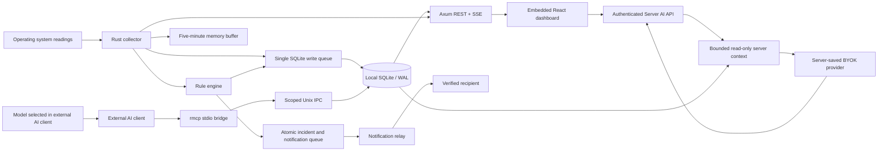

# Architecture

## Directories

- `crates/core`: data contracts, time-based rule engine, aggregation, redaction, and SQLite.
- `crates/agent`: operating system collector, target workers, auth/API/SSE, MCP,
  notification scheduler, AI, and webhooks.
- `crates/relay`: device authorization, recipient verification, and Postmark/test adapters.
- `web`: React/TypeScript, locally bundled IBM Plex fonts, ECharts, and Tailwind/CSS.
- `scripts`, `packaging`: build, install, uninstall, and acceptance tests.

## Metric semantics

Total CPU is 0–100% across all cores. Process CPU is measured against one core and
can exceed 100%. The first CPU delta sample is unavailable. Network counter deltas
are divided by actual elapsed time; rates are unavailable after counter resets or
sleep. Collection uses a monotonic clock; records use UTC seconds. Wall-clock jumps
appear as gaps in data coverage.

Linux memory usage follows total minus MemAvailable. On macOS, sysinfo 0.40.1's
`available_memory` includes active pages, so the Linux calculation is misleading.
The Mac collector uses native `used_memory` accounting (application + wired +
compressor, excluding purgeable pages). This percentage is not the same measure as
macOS Memory Pressure. Sources: [sysinfo System](https://docs.rs/sysinfo/0.40.1/sysinfo/struct.System.html),
[Apple XNU memory notes](https://github.com/apple-oss-distributions/xnu/blob/main/doc/vm/memorystatus_notify.md).

Process identity combines PID and start time. Host identity is generated at first
installation and persisted. The Docker helper returns the full container ID. Do
not bake the data directory into a reusable image: cloned servers must start with
an empty directory to receive distinct identities. Container history is held in
the host agent's SQLite database, not in a container's writable layer.

## Retention and failure handling

SQLite has one writer thread and a bounded queue. Reads use separate connections
and short, indexed queries. Normal storage uses minute summaries. Incident detail
preserves the one-second buffer. Higher-level aggregation and deletion of its
source records share one transaction; failure rolls back both. Summaries retain
total transfer, min/max/first/last/average, and observed seconds.

Quota enforcement progressively removes optional AI cache entries, old incident
details, and then older records. All incremental-vacuum result rows are consumed
before a WAL checkpoint. The SQLite page cap is 85% of the budget; remaining space
is reserved for WAL and auxiliary files. An unusually long reader or large external
file can temporarily exceed the budget. The dashboard exposes this condition and
detail recording stops. Pending notifications, administrator secrets, and open
incidents are never silently deleted. Normal retention durations are not guaranteed
under quota pressure.

Incidents and their outbound messages are written atomically. Live collection
continues during database failures; a bounded memory queue retries writes and
reports visible errors if it overflows. Unwritten in-memory samples cannot survive
a full process shutdown.

## Built-in rules

Balanced: CPU >80% for a 5-minute window and >90% for 3 minutes; memory >90% for
5 minutes and >95% for 3 minutes. Conditions must hold for 80% of the window with at
least 90% valid data coverage. CPU/memory recover after 2 minutes below a threshold
5 percentage points lower. The sensitive preset uses 2-minute windows and thresholds
10 points lower. Sustained-load rules use CPU >70% for 60 minutes and memory >85% for
30 minutes. Apply presets in one click and edit them in the form.

Disk, HTTP, and service checks use consecutive observations, separate from continuous
metric windows. An incident for the same source/metric escalates and recovers under
one ID.

## MCP historical questions

MCP exposes ten scoped, read-only tools through local or SSH stdio. There is no
HTTP MCP endpoint or cross-server selector. `history` reads aggregates;
`metric_report` adds weighted summaries, peak intervals, trends, optional
period comparison and aligned related-metric analysis. `process_history`,
`monitored_sources` and `monitoring_health` expose recorded snapshots, configured
checks and collection/coverage health. Inventory and incident/log-summary tools
complete the ten-tool allowlist. [Tool contract and permissions](MCP_CONNECTIONS.md)

Metric windows are bounded to 366 days and 2,000 returned history points, subject
to collected history, retention and response limits. Only source buckets wholly
inside the requested window are used. Coverage, unknown intervals and invalid or
overlapping records are explicit. A new installation cannot supply history from
before collection began. A peak is an aggregate interval, not an exact second.

Process resource snapshots are collected prospectively about once per minute and
retained for seven days; available incident-time observations can contribute.
Their absence cannot be repaired from a current process list. The latest configured
monitor state is not a continuous uptime history. Log summaries are latest-check
counts, not arbitrary file reads or full historical searches.

The selected model in the **calling external AI client** interprets the tool
results. MCP reads do not invoke the server's saved Grok/BYOK provider. The MCP
key authorizes scoped reads; the client's model/account/billing are independent.
Running that client on a Mac does not establish local model execution. Statistical
co-movement and outliers remain descriptive, never root-cause certainty.

## Server AI and incident explanations

Reading metrics and evaluating rules do not call AI. **Server AI** is a manual,
text-only authenticated browser API using the installation's existing verified
BYOK connection. Six provider choices use automatic internal models/endpoints.
The UI is English; chat replies follow Turkish or English questions and remain
short. Natural-language periods select bounded context, defaulting to three hours.
The chat-specific copy uses readable UTC labels on known time paths; numeric
analysis/MCP fields, measured values, units and durations remain intact.

The evidence builder reads only this server's fixed, bounded monitoring context:
current readings, metric summaries, configured checks, data-health warnings,
recent incidents and recorded process context. There are no model tools for
commands, arbitrary files/URLs/SQL or server changes. Both evidence strings and
prior assistant answers are untrusted data. Local request admission, redaction,
strict input fields, context/output limits and independent coverage notices
supplement the fixed data boundary. A system prompt is not that boundary.

Chat permits 20 provider attempts per UTC day, one AI operation at a time, and
bounded request/response time. Failed provider attempts count; local refusals do
not. There is no automatic chat retry. Conversation is held only in the signed-in
page state. [Chat contract and checks](SERVER_AI_CHAT.md)

Manual incident analysis sends bounded, redacted event evidence through the same
saved provider connection, with its own 10-request daily budget and cache. Automatic
explanations are off by default and apply only to eligible unexplained important
events when enabled; routine CPU/memory/disk triggers are explained by local rules.
Critical notification delivery never waits for AI. Event prompts, notifications
and MCP tool descriptions use English; chat can answer Turkish.

## Sign-in and installation boundary

The Rust listener remains on loopback behind the guided HTTPS proxy or an SSH
forward. Guided installation creates a password-based account; MFA is optional.
Manual first-time setup retains its private expiring key flow. Existing accounts
cannot be replaced by rerunning setup. Browser-session cookies remain valid until
explicit revocation/browser session handling; there is no fixed idle lifetime or
five-minute step-up prompt. Origin, Host, session and CSRF checks still apply.
Password/MFA changes revoke sessions. See [Security](SECURITY.md) and the root-only
recovery/removal procedures in [Operations](OPERATIONS.md).

Source, release artifact and deployment are separate states: code/tests establish
implementation behavior; release metadata/checksums identify a packaged commit;
service, TLS and browser acceptance establish the result on a specific host.
