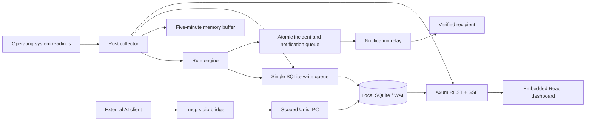

# Architecture

## Directories

- `crates/core`: data contracts, time-based rule engine, aggregation, redaction, and SQLite.
- `crates/agent`: operating system collector, target workers, auth/API/SSE, MCP,
  notification scheduler, AI, and webhooks.
- `crates/relay`: device authorization, recipient verification, and Postmark/test adapters.
- `web`: React/TypeScript, locally bundled IBM Plex fonts, ECharts, and Tailwind/CSS.
- `scripts`, `packaging`: build, install, uninstall, and acceptance tests.

## Metric semantics

Total CPU is 0–100% across all cores. Process CPU is measured against one core and
can exceed 100%. The first CPU delta sample is unavailable. Network counter deltas
are divided by actual elapsed time; rates are unavailable after counter resets or
sleep. Collection uses a monotonic clock; records use UTC seconds. Wall-clock jumps
appear as gaps in data coverage.

Linux memory usage follows total minus MemAvailable. On macOS, sysinfo 0.40.1's
`available_memory` includes active pages, so the Linux calculation is misleading.
The Mac collector uses native `used_memory` accounting (application + wired +
compressor, excluding purgeable pages). This percentage is not the same measure as
macOS Memory Pressure. Sources: [sysinfo System](https://docs.rs/sysinfo/0.40.1/sysinfo/struct.System.html),
[Apple XNU memory notes](https://github.com/apple-oss-distributions/xnu/blob/main/doc/vm/memorystatus_notify.md).

Process identity combines PID and start time. Host identity is generated at first
installation and persisted. The Docker helper returns the full container ID. Do
not bake the data directory into a reusable image: cloned servers must start with
an empty directory to receive distinct identities. Container history is held in
the host agent's SQLite database, not in a container's writable layer.

## Retention and failure handling

SQLite has one writer thread and a bounded queue. Reads use separate connections
and short, indexed queries. Normal storage uses minute summaries. Incident detail
preserves the one-second buffer. Higher-level aggregation and deletion of its
source records share one transaction; failure rolls back both. Summaries retain
total transfer, min/max/first/last/average, and observed seconds.

Quota enforcement progressively removes optional AI cache entries, old incident
details, and then older records. All incremental-vacuum result rows are consumed
before a WAL checkpoint. The SQLite page cap is 85% of the budget; remaining space
is reserved for WAL and auxiliary files. An unusually long reader or large external
file can temporarily exceed the budget. The dashboard exposes this condition and
detail recording stops. Pending notifications, administrator secrets, and open
incidents are never silently deleted. Normal retention durations are not guaranteed
under quota pressure.

Incidents and their outbound messages are written atomically. Live collection
continues during database failures; a bounded memory queue retries writes and
reports visible errors if it overflows. Unwritten in-memory samples cannot survive
a full process shutdown.

## Built-in rules

Balanced: CPU >80% for a 5-minute window and >90% for 3 minutes; memory >90% for
5 minutes and >95% for 3 minutes. Conditions must hold for 80% of the window with at
least 90% valid data coverage. CPU/memory recover after 2 minutes below a threshold
5 percentage points lower. The sensitive preset uses 2-minute windows and thresholds
10 points lower. Sustained-load rules use CPU >70% for 60 minutes and memory >85% for
30 minutes. Apply presets in one click and edit them in the form.

Disk, HTTP, and service checks use consecutive observations, separate from continuous
metric windows. An incident for the same source/metric escalates and recovers under
one ID.

## MCP historical questions

MCP exposes stored data through six read-only tools; it is not limited to predefined
alarm rules. An AI client can call `server_info` for the source ID, then `history`
for `cpu` and `memory` over the same UTC range. A request for the last 24 hours
normally returns minute summaries, subject to available history and retention.
Each row includes time bounds, min/max, first/last, weighted sum, and observed seconds.
The client can calculate averages and coverage, align both series, and present a
table of increases, decreases, and coincident peaks.

There is no dedicated correlation or root-cause tool in this release. Interpretation
and table formatting belong to the requesting AI client. Correlation does not prove
causation. Minute summaries cannot establish the exact second of a peak or reconstruct
the exact duration above every possible threshold. Missing history must be reported
as unavailable, not invented. A newly installed agent cannot provide 24 hours of
real history before it has collected them. Queries are bounded to 366 days and
2,000 points; the response states the selected resolution. See the integration test
for isolated synthetic CPU/memory history fixtures.

## AI

Reading metrics and evaluating thresholds do not call AI. Manual analysis sends
bounded, redacted evidence from the selected incident. Existing automatic alarm
classes are explained by known rules and therefore do not start AI requests.
Automatic analysis is opt-in and uses a separate durable queue for new unexplained
incident types. Critical notification delivery never waits for AI. Product prompts,
notifications, and MCP descriptions use English; external clients may choose their
own conversational language.
